# Melior in diagrams

How the pieces fit together, from the outside in. The text in `README.md` is the
reference; these diagrams are the map.

1. [The system](#1-the-system)
2. [Where media flows](#2-where-media-flows)
3. [Server crates and layers](#3-server-crates-and-layers)
4. [Ports and adapters](#4-ports-and-adapters)
5. [Frontend structure](#5-frontend-structure)
6. [Logging in](#6-logging-in)
7. [Joining a room](#7-joining-a-room)
8. [Negotiation states](#8-negotiation-states)
9. [Forwarding and reusing media sections](#9-forwarding-and-reusing-media-sections)
10. [Who may enter a voice channel](#10-who-may-enter-a-voice-channel)
11. [When the server closes a connection](#11-when-the-server-closes-a-connection)
12. [Several server instances](#12-several-server-instances)
13. [Voice presence in the community](#13-voice-presence-in-the-community)
14. [Access over Tailscale](#14-access-over-tailscale)
15. [Route of a link](#15-route-of-a-link)
16. [Switching from forwarded to direct](#16-switching-from-forwarded-to-direct)

## 1. The system

The browser talks to one origin. The frontend's proxy (Vite in development,
nginx in the image) passes the backend paths on to the SFU, which is also the
backend-for-frontend for login.

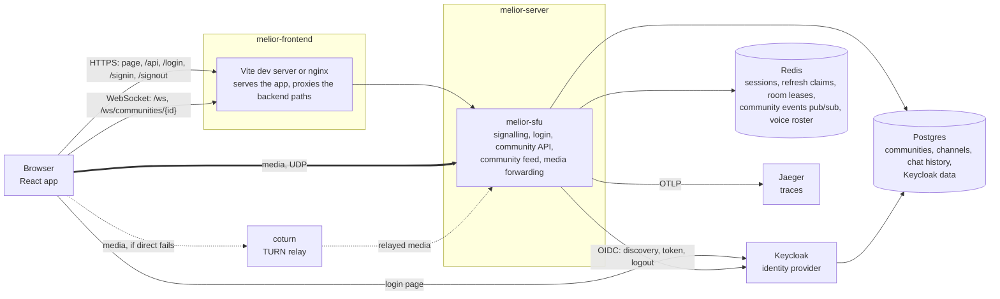

## 2. Where media flows

A room sends media over one of two paths. In a room of up to
`MELIOR_MESH_MAX_PARTICIPANTS` people (default 4) the browsers connect to each
other, *direct*. In a bigger room each browser has one connection to the SFU:
it sends its own camera and microphone there and receives everyone else's from
there, *forwarded*. The SFU forwards packets; it does not decode or mix them.
TURN is the fallback for both: for a browser that cannot reach the SFU, and for
a pair of browsers that cannot reach each other. The SFU itself never uses it.

The SFU connection stays open in a mesh room, so the room can switch to
forwarding without a new connection.

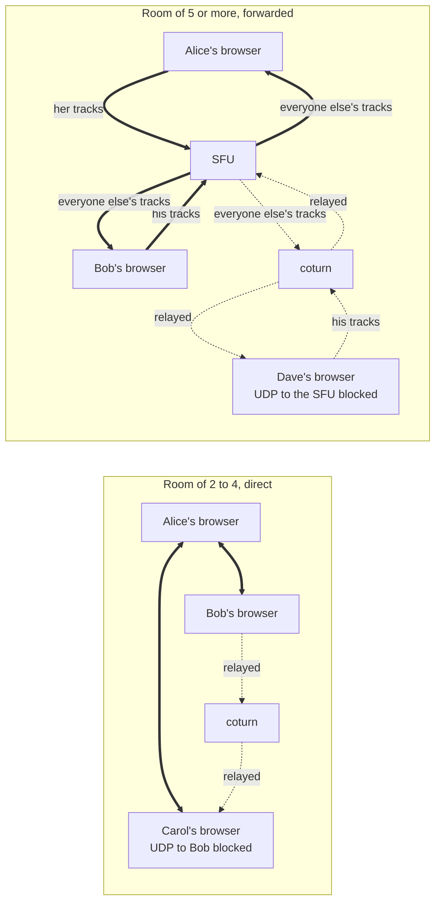

In a mesh room with `n` participants each browser sends `n - 1` copies of its
tracks (camera, microphone and, while it shares, its screen in a fixed third
section of each link), and the SFU sends nothing; its connection is open but the uplink is
paused. In a forwarded room the SFU receives `n` sets of tracks and sends
`n * (n - 1)`. Signalling always goes through the server, which relays the
offers, answers and candidates of the direct links.

During a switch both paths carry media, one pair at a time; see
[section 15](#15-route-of-a-link) and [section 16](#16-switching-from-forwarded-to-direct).

## 3. Server crates and layers

One crate per layer. An arrow means "depends on"; `cargo xtask layers` fails the
build if an arrow points any other way, or if a crate uses a library its layer
may not.

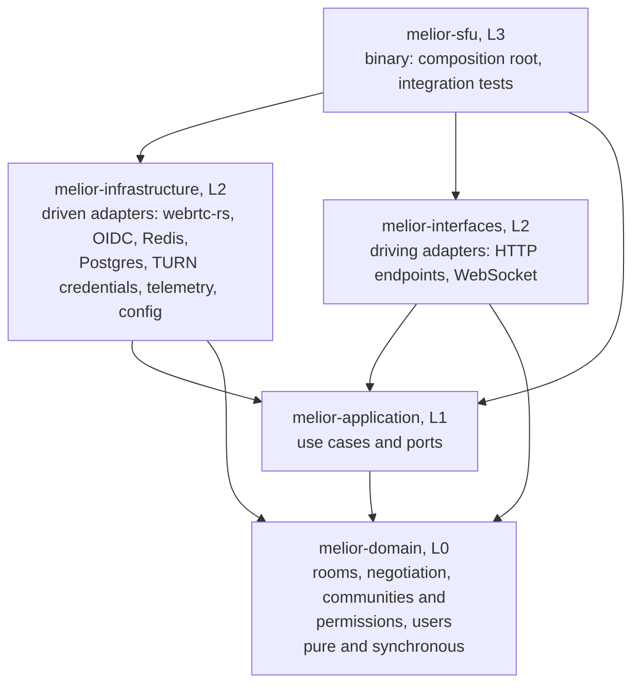

| Crate | May not use |
| --- | --- |
| `melior-domain` | any async runtime, logging, or I/O library |
| `melior-application` | axum, webrtc, redis, sqlx, reqwest, opentelemetry |
| `melior-infrastructure` | a web framework; `melior-interfaces` |
| `melior-interfaces` | webrtc, redis, sqlx, reqwest; `melior-infrastructure` |

## 4. Ports and adapters

The use cases name traits, never technologies. Driving adapters call the
services; driven adapters implement the ports. Tests put in-memory
implementations and fakes behind the same ports.

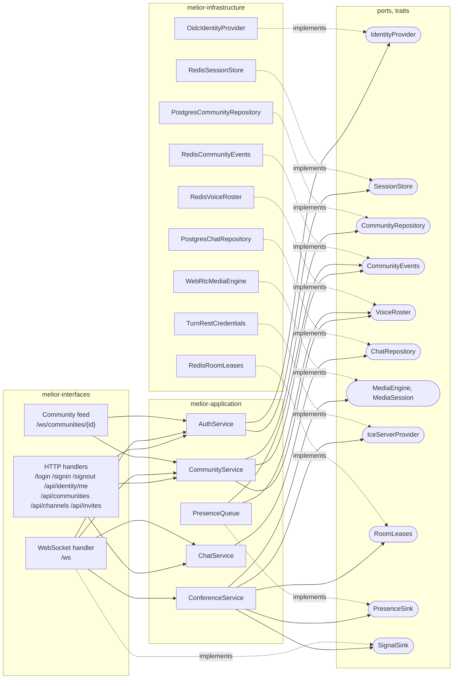

`WebRtcMediaEngine` reports what it observes (a track published, a track ended,
the connection established, a local ICE candidate) back to `ConferenceService`
through the `MediaEvents` port. `ConferenceService` reports who is in which
voice channel to the `PresenceSink` port without waiting; `PresenceQueue`
implements it in the application and keeps the voice roster and the community
events from one task.

## 5. Frontend structure

Routes compose features; inside a feature, dependencies run one way.

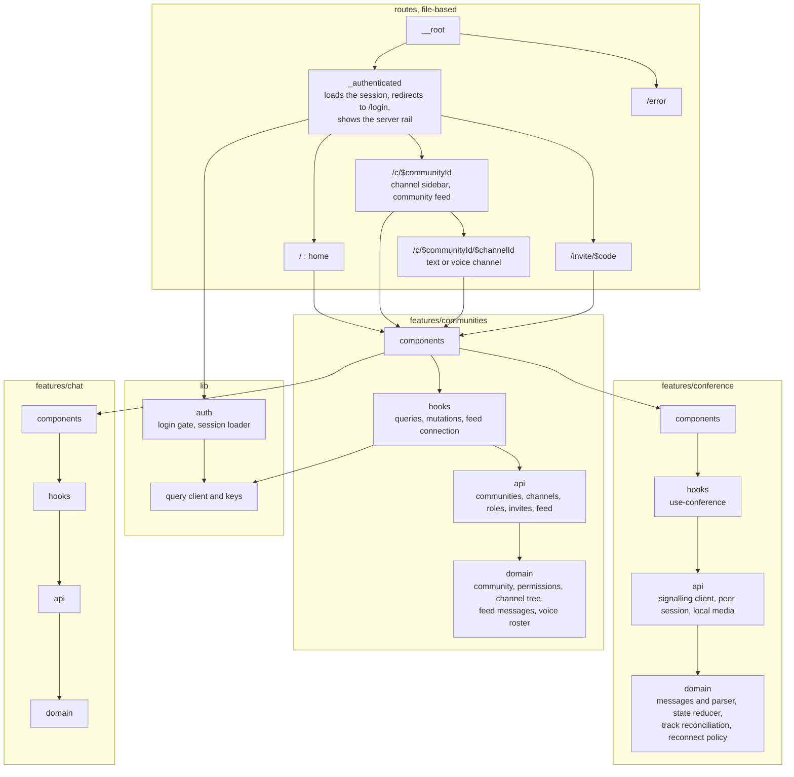

## 6. Logging in

The server runs the whole OpenID Connect exchange. The browser only follows
redirects and ends up with an opaque session cookie; tokens stay in Redis.

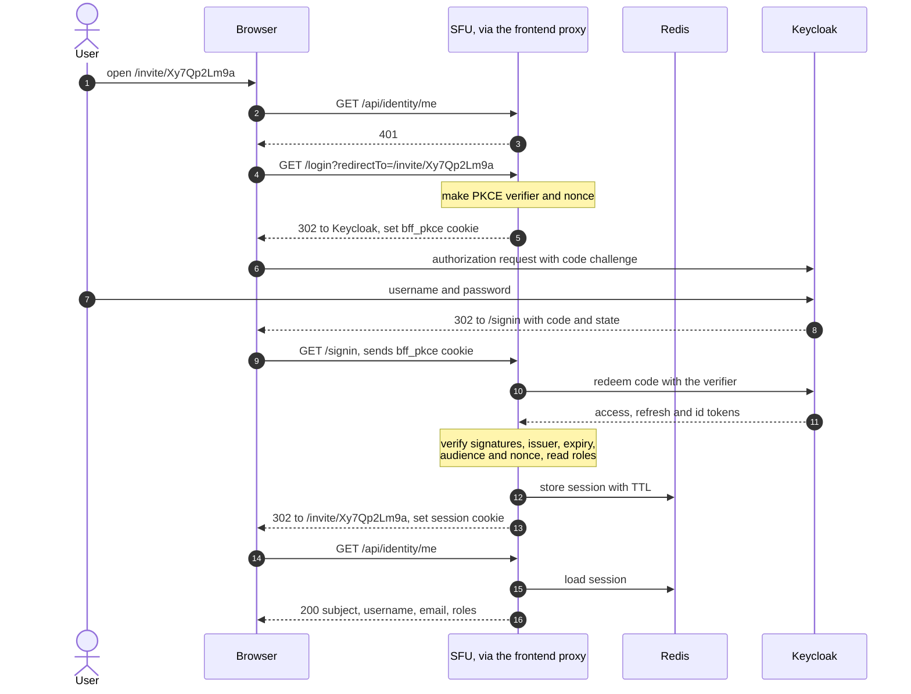

Later requests refresh the tokens shortly before they expire. A refresh that
Keycloak rejects ends the session; one that cannot be attempted leaves it alone.

## 7. Joining a room

The upgrade is refused before any WebSocket exists unless every check passes:
the channel permissions of [section 10](#10-who-may-enter-a-voice-channel), the
room lease (503) and the room's capacity (409 when it is full). A browser cannot
see the status of a refused upgrade, so the client asks
`GET /api/channels/{channel_id}/admission` for it. After that the client offers
once, and the server drives every later renegotiation.

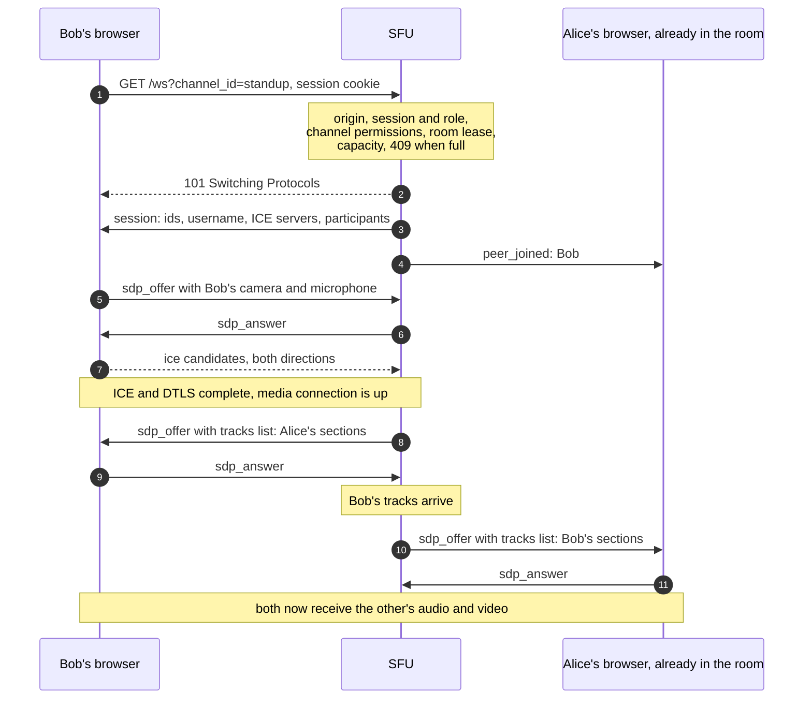

The `tracks` list in every server offer is complete: `mid` and `session_id` for
each media section that carries someone's track. Clients attribute media from
that list, never from stream ids.

## 8. Negotiation states

One offer/answer exchange at a time per participant. A change that arrives while
an offer is outstanding is remembered and negotiated when the answer is in.

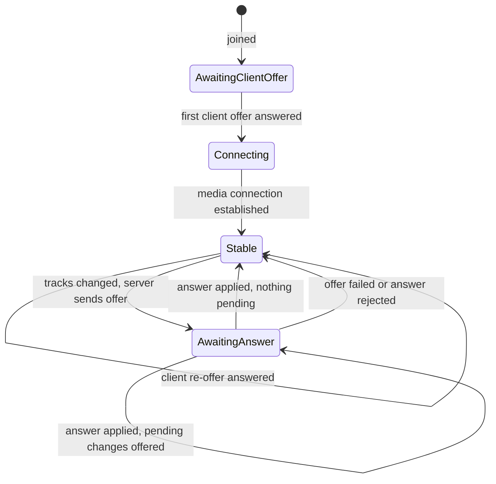

A participant receives other people's tracks only from `Stable` onwards, so a
renegotiation can never race the initial connection setup.

## 9. Forwarding and reusing media sections

A forwarder reads one published track and writes it to the outlet of every
subscriber. An outlet is one media section of a subscriber's connection. It
outlives the track it was opened for.

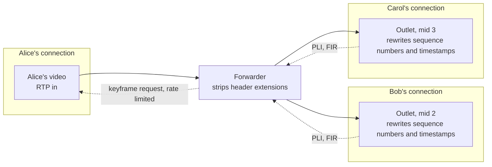

When a publisher leaves, the outlets that carried their tracks go idle and take
the next publisher's track of the same codec, so a session description stops
growing with churn.

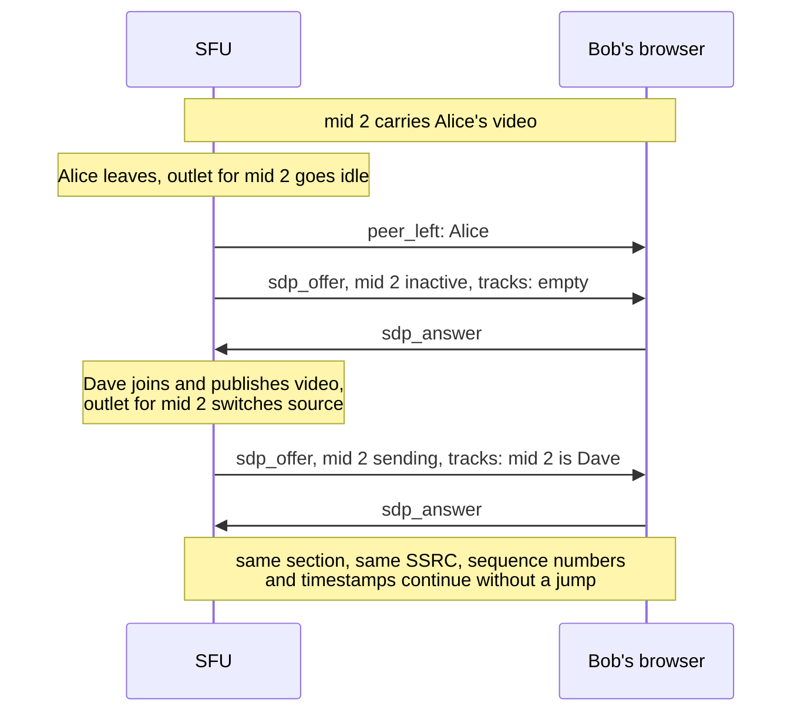

## 10. Who may enter a voice channel

The same decision is taken at the WebSocket upgrade and again on every re-check
while someone is connected; the re-check leaves out the capacity, so a lowered
limit does not remove anyone. Between the permissions and the capacity the
upgrade also needs the room lease (503, see [section 12](#12-several-server-instances)).

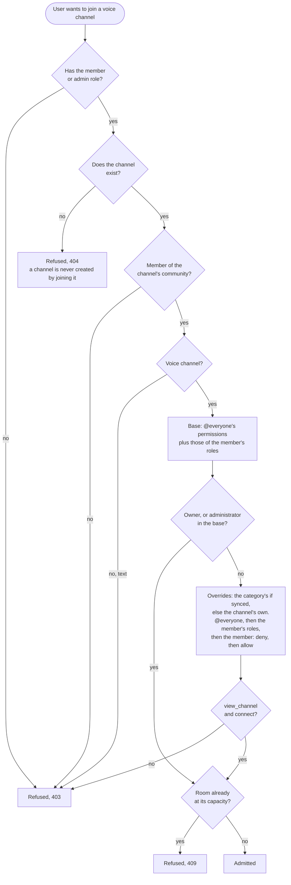

## 11. When the server closes a connection

Every `SESSION_RECHECK_SECONDS` each open connection asks three questions. Only
a definite "no" ends it; if a store cannot be reached, the connection stays.

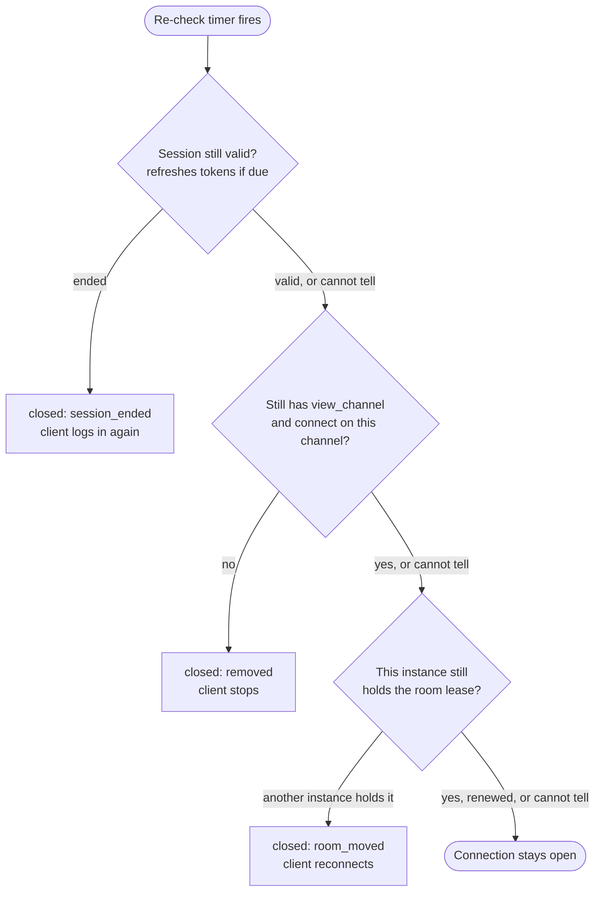

"No" there also covers a member who was kicked or left, and a channel or
community that was deleted. On any other loss (socket drops, peer connection fails, an upgrade answered
with 503) the client reconnects by itself with exponential backoff.

## 12. Several server instances

A room's media state lives in one instance's memory, so a room is pinned: the
proxy hashes the channel id to pick an instance, and a lease in Redis guarantees
that only one instance ever hosts a given room. A community feed works on any
instance, because voice presence and community events cross instances through
Redis (see [section 13](#13-voice-presence-in-the-community)). The Vite proxy
hashes `/ws/communities/<id>` by community id to spread the feeds out; nginx
sends it round robin.

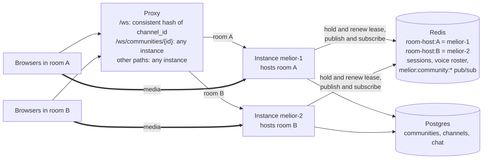

When an instance stops, its rooms come back on another one after the lease
expires:

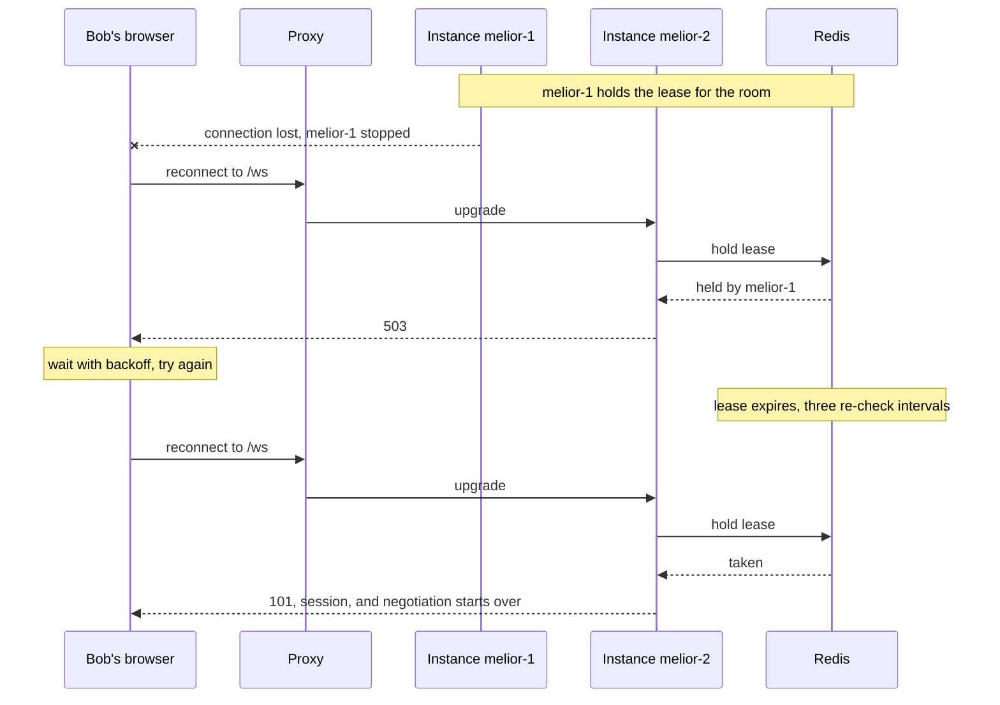

## 13. Voice presence in the community

Members who are not in a call still see who is in each voice channel, and
whether they speak, show a camera or a screen, or are muted. A room never waits
for this: it only queues a report, and one task per instance stores it and
publishes it.

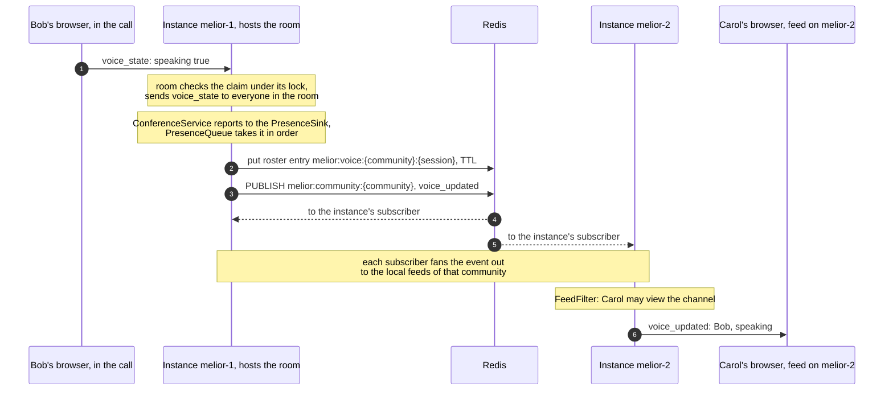

A feed drops voice entries and messages for channels its member may not view.
A new feed, and every feed after a re-check, starts from a `snapshot` read from
the roster. An entry lives three re-check intervals and is renewed on every
re-check, so the participants of an instance that stopped disappear with the
next snapshot.

## 14. Access over Tailscale

`docker/tailscale.sh up` publishes the app and Keycloak on the tailnet over
HTTPS. Media does not pass through `tailscale serve`; it goes to the machine's
tailnet address directly.

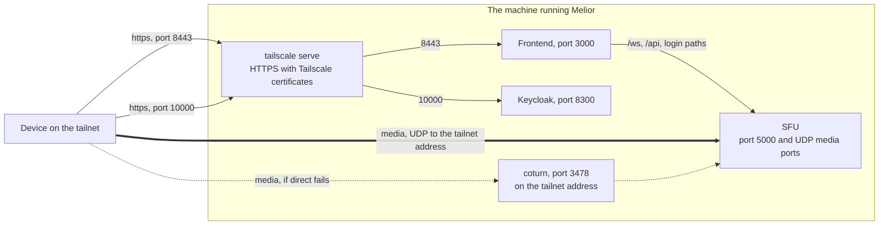

## 15. Route of a link

The server keeps one link per pair of participants. Its route says which path
carries the pair's media. Every transition adds one to the link's `epoch`, and a
`route_live` report counts only for the current epoch.

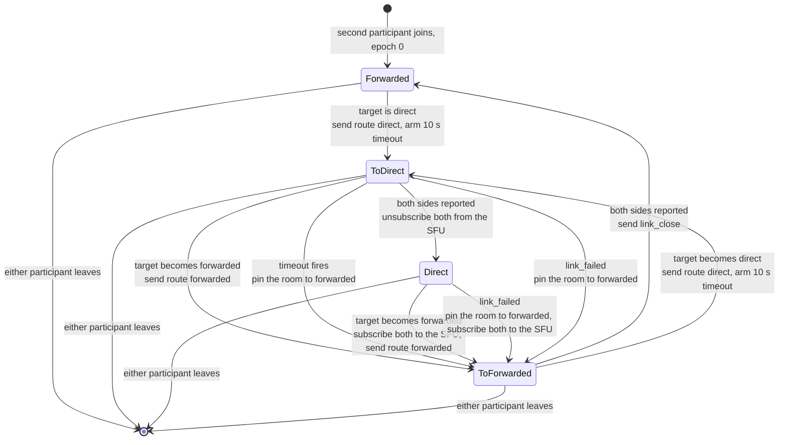

`ToForwarded` has no timeout: the direct link keeps working until both sides
report. A `link_failed` from either side acts like the timeout, in `ToDirect`,
`Direct` and `ToForwarded`; in `ToForwarded` the link already moves back, so only
the pin changes. In `Forwarded` it is ignored. On a leave, the remaining participant gets `link_close` if the link was
in any state but `Forwarded`.

## 16. Switching from forwarded to direct

Alice's session id sorts lower than Bob's, so she makes the offer on the direct
link. Both browsers keep playing the SFU path until the direct path has decoded
media. Bob joins a room where Alice is alone and the target is `direct`.

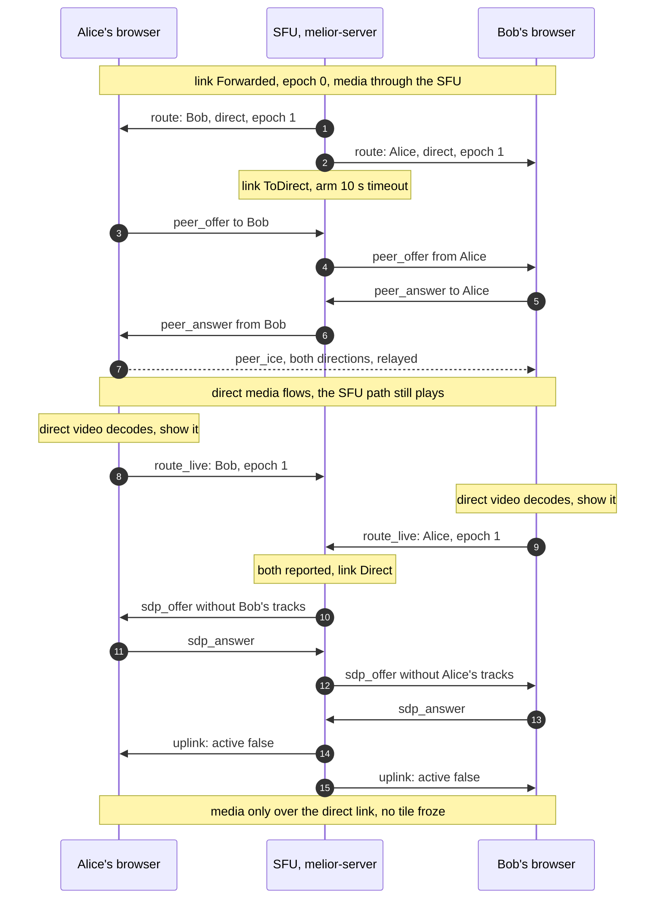

The `uplink` message goes to a participant only when every one of its links is
`Direct`. Going back is the same sequence in the other direction: `route`
`forwarded` first, the SFU subscriptions return and `uplink` `active` is
`true`, and `link_close` follows once both report.
