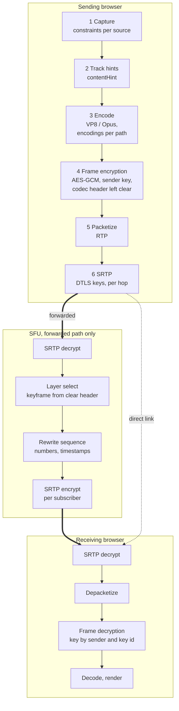

# The media send pipeline

Status, November 2026: steps 1 (compression), 2 (end-to-end encryption) and
3 (simulcast) are **built**. `README.md` (Media
encoding, End-to-end encryption) is the reference for what is built, and
[`e2ee-risks.md`](e2ee-risks.md) records what encryption does not protect.
Where the build differs from this proposal, section 11 says how and why. This
document covers what happens to a camera, microphone or screen track between
capture and the network: compression and encryption.

1. [Today](#1-today)
2. [The target pipeline](#2-the-target-pipeline)
3. [Compression](#3-compression)
4. [End-to-end encryption](#4-end-to-end-encryption)
5. [Simulcast in the SFU](#5-simulcast-in-the-sfu)
6. [Protocol changes](#6-protocol-changes)
7. [Where the code goes](#7-where-the-code-goes)
8. [Delivery order](#8-delivery-order)
9. [Decisions](#9-decisions)
10. [Open questions](#10-open-questions)
11. [How the build differs](#11-how-the-build-differs)

## 1. Today

Melior configures neither compression nor encryption. The browser and
webrtc-rs defaults decide both.

| Stage | What happens | Where |
|---|---|---|
| Capture | `getUserMedia` with `video: true` (no resolution or frame-rate limit); audio with echo cancellation, noise suppression and gain control. `getDisplayMedia` with `video: true`. | `melior-frontend/apps/web/src/features/conference/api/local-media.ts` |
| Encode | The browser's default codec choice from the offer/answer, its own bitrate and resolution adaptation, one encoding per sender. No `contentHint`, no `degradationPreference`, no `maxBitrate`. | `api/peer-session.ts` (`addTrack`, `addTransceiver`), `api/direct-sections.ts` |
| Pause | `encodings[*].active` toggles the SFU uplink without renegotiating. | `api/uplink.ts` |
| Encrypt | DTLS-SRTP, mandatory in WebRTC. Per hop: the SFU decrypts every packet. | the browser and webrtc-rs |
| Server | Registers the default codecs and interceptors (NACK, RTCP reports, TWCC), forwards RTP unchanged except for header extensions, sequence numbers and timestamps, relays rate-limited keyframe requests. | `melior-server/crates/melior-infrastructure/src/webrtc/engine.rs`, `webrtc/forwarder.rs`, `webrtc/session.rs` |

Consequences:

- The SFU, and anyone who controls it, can read every forwarded frame. Media
  on a direct link is end to end only because no server sits on that path.
- A room can mix codecs, which keeps one set of media sections per codec (see
  `README.md`, Limitations).
- A shared screen is encoded like a camera: under load the browser drops
  resolution, so text blurs.
- Every receiver of a forwarded track gets the same single encoding, whatever
  its tile size or bandwidth.

## 2. The target pipeline

Every outgoing track passes the same stages on every path. A receiver
therefore decodes a peer's media the same way over the SFU and over a direct
link, and the make-before-break switch never changes how a frame is read.



Two layers of encryption result:

- **Frame encryption (new, stage 4)** protects the media from the SFU and from
  everyone outside the room. Only participants hold the keys.
- **SRTP (unchanged, stage 6)** protects each hop and keeps the RTP headers
  away from the network. The SFU still holds these keys; it needs the RTP
  headers to route packets.

## 3. Compression

One pure function decides the encoder settings: given the source (camera or
screen), the path (SFU or direct link) and the number of direct peers, it
returns the capture constraints, the codec order, the encodings and the
hints. The API layer only applies the result.

### 3.1 Codec preference

- **Video: VP8 only**, set with `RTCRtpTransceiver.setCodecPreferences` on
  every video transceiver, keeping the `rtx` entry for retransmission.
- **Audio: Opus** (every browser's default).
- The server registers only VP8 and Opus. A client that offers nothing else is
  refused at the edge with an `error`, the same way a malformed offer is.

Why VP8: every browser supports simulcast with it, its frame header is short
and fixed (which the clear prefix of section 4.3 needs), and the SFU can find
a keyframe from that header without decoding. One codec per room also removes
the "mixed codecs" limitation on media-section reuse. VP8 serves the
screen too (section 9).

### 3.2 Settings per source and path

Its numbers are starting points to tune with `getStats()`, not measured
values.

| | Camera, SFU | Camera, direct link | Screen (both paths) | Microphone |
|---|---|---|---|---|
| Capture | 1280x720 ideal, 30 fps max | same track | `frameRate` 15 max | unchanged |
| `contentHint` | `motion` | `motion` | `detail` | `speech` |
| `degradationPreference` | `balanced` | `balanced` | `maintain-resolution` | — |
| Encodings | simulcast: `q` 1/4 scale, 150 kbit/s, 15 fps; `h` 1/2 scale, 500 kbit/s; `f` full, 1.5 Mbit/s | one encoding, no `maxBitrate`: congestion control sets the rate (section 3.3) | one encoding, `maxBitrate` 2.5 Mbit/s | one encoding |

- A direct link carries no simulcast: it has exactly one receiver, so
  single-stream adaptation (section 3.3) fits that receiver's network better
  than any fixed layer.
- A screen gets one high layer on purpose: a smaller layer of text is
  unreadable, so a receiver that cannot take the full layer gets fewer frames
  per second instead.
- The encodings change with `setParameters`, so a change of path never
  renegotiates. Simulcast encodings are set once, in
  `addTransceiver({ sendEncodings })`, because the browser fixes their number
  at negotiation.

### 3.3 Single-stream adaptation on direct links

On a direct link the browser's congestion control (Google Congestion Control,
GCC) adapts one stream to the receiver. The receiver reports arrival times
through transport-wide congestion control (TWCC) feedback, or REMB on older
stacks. The sender's estimate then raises or lowers the bitrate, and the
encoder follows with resolution and frame rate under `degradationPreference`.
A fixed `maxBitrate` would only cut that estimate off, so the direct-link
camera sets none.

- **Several peers.** In a room of 3 or 4, each direct link runs its own GCC
  against its own receiver, and all of them share the sender's uplink. Each
  estimate backs off when that shared uplink queues, so the links are expected
  to settle without a cap. Section 8.1 tests this; if they do not settle, a
  ceiling per link is the fallback (open question 1).
- **Starting point.** GCC starts low and ramps up, which is the "quality ramps
  up for a few seconds" after a switch that `README.md` lists. Nothing here
  changes that.
- **The SFU path keeps simulcast.** The SFU does not transcode, so it cannot
  adapt one stream to several receivers. It picks a layer per receiver
  instead (section 5). The browser's GCC still adapts the publisher's uplink
  to the SFU, and drops the top layers when that uplink is short.

### 3.4 One writer per sender

`api/uplink.ts` already calls `setParameters` to pause the uplink, and the
browser rejects a second `setParameters` while one runs. The compression
settings and the pause must therefore go through one writer per sender, which
merges "which encodings are active" (pause, and later the layers the SFU wants)
with "what each encoding sends" (section 3.2). A resumed uplink restores the
active layers it had, not every layer.

## 4. End-to-end encryption

### 4.1 What it protects, and what it does not

Rules:

- Every participant encrypts every frame it sends with its own sender key.
- A receiver decrypts a frame with the sender key of the participant who sent it.
- The server never holds a sender key.
- When a participant joins or leaves, every participant in the room replaces
  its sender key.

What the rules give:

- **Protected:** frame contents from the SFU, from TURN, from the network,
  and, after rotation, from someone who left (no future frames) or joined (no
  earlier frames).
- **Not protected:** the RTP headers, frame sizes and timing, which the SFU
  sees and needs; chat, which the server stores; and who is in the room.
- **Not protected: a server that swaps keys.** The server relays the public
  keys, so a compromised server can replace them and read the media (man in
  the middle), and no participant notices. The design accepts this so that
  nobody has to compare or enter a code. It protects against a server, TURN
  relay or network that only passes media along.
- **Not protected at all: the app itself.** Melior's server also delivers the
  frontend code. A compromised server can ship JavaScript that uses the
  private key or sends the sender keys away, although it cannot export the
  private key. In-browser encryption protects against a server that only
  forwards media, not against one that changes the app. Every web-based
  end-to-end encryption shares this limit.

### 4.2 Keys

1. **Session key pair.** On joining a voice channel, the browser creates an
   ECDH P-256 key pair with `crypto.subtle.generateKey`, with
   `extractable: false`. The private key is a `CryptoKey` in that tab's memory.
   JavaScript can use it but cannot read its bytes, and it is never stored or
   sent. The browser sends the public key to the server once (`e2ee_public`).
   The server keeps it with the participant and hands it out in `session` and
   `peer_joined`. Leaving, reconnecting or closing the tab discards the pair;
   the next join creates a new one.
2. **Pairwise key.** Two participants derive a shared wrapping key from ECDH
   and HKDF-SHA-256. The salt is both session ids in sorted order, so both
   sides derive the same key.
3. **Sender key.** Each participant draws a random 128-bit AES-GCM key and a
   key id (one byte, wrapping). It wraps the key for each peer with that
   peer's pairwise key and sends it as `e2ee_sender_key`, relayed by the
   server like `peer_offer`.
4. **Rotation.** On every `peer_joined` and `peer_left`, each participant
   draws a new sender key, sends it to everyone present, and switches to it
   after the newest peer acknowledged it or after 1 second, whichever comes
   first. One code path serves joins and leaves; a hash ratchet for joins is a
   later optimisation.
5. **Key ring.** A receiver keeps the current and the previous key of each
   sender, chosen by key id, so frames in flight during a rotation still
   decrypt.

Why a key pair per session and not per user or per device: nothing is stored,
so there is no key to lose, back up or sync across devices, and the server
needs no key registry. The price is that a key says nothing about who someone
was in an earlier call, so a swapped key cannot be detected. A lasting key
per device (a non-extractable `CryptoKey` in IndexedDB) can replace it later
without changing the frame format. The client would then warn only when a
contact's key changes, with nothing to compare or enter.

### 4.3 Frame format

The browser hands each encoded frame to an `RTCRtpScriptTransform` worker
before packetization. The worker rewrites it as:

```text
| clear prefix | ciphertext | GCM tag (16) | counter (8) | key id (1) |
```

- **Clear prefix:** VP8 keyframe 10 bytes, VP8 delta frame 3 bytes, Opus 1
  byte (the TOC byte). The SFU reads the keyframe flag from it, and the
  receiver's depacketizer sees a valid frame start.
- **Nonce:** a 96-bit salt derived from the sender key, XORed with the 64-bit
  frame counter. The counter rises with every frame and restarts at 0 with a
  new key, so no nonce repeats under one key.
- **Additional data:** the clear prefix and the trailer, so the SFU cannot
  alter what it can read.
- A frame that fails to decrypt (unknown key id, bad tag) is dropped, never
  passed to the decoder. The receiver's decoder then asks for a keyframe as
  it does after loss.

`RTCRtpScriptTransform` runs in Chrome and Edge 141 and later, Firefox 117 and
later, and Safari 15.4 and later
([MDN](https://developer.mozilla.org/en-US/docs/Web/API/RTCRtpScriptTransform)).
The Chrome-only `createEncodedStreams` API is not used. A browser without
`RTCRtpScriptTransform` does not join: the client says the browser cannot
encrypt calls and asks for an update. One unencrypted participant would end
the guarantee for the whole room. The server cannot enforce this, since a
client can claim anything, but it does not need to: a participant who sends
no `e2ee_public` gets no sender keys, so it can see nothing, and the others
drop its unencrypted frames.

### 4.4 Cost

About 25 bytes and one AES-GCM operation per frame on each sender and
receiver. A direct link pays it too, although DTLS already protects it end to
end: in exchange, one decode path serves both paths.

## 5. Simulcast in the SFU

- **Ingress.** webrtc-rs reports each simulcast layer as its own remote track
  with a `rid`. The forwarder of a published video track becomes a set of
  layer readers, one per `rid`.
- **Selection.** Each outlet carries one layer at a time. A switch waits for a
  keyframe on the target layer: the forwarder sends a PLI for that layer and
  switches at the first packet whose VP8 payload descriptor starts a frame and
  whose clear prefix marks a keyframe. The existing `Continuity` mapping
  already keeps sequence numbers and timestamps continuous across a switch.
- **Decision.** A rule in `melior-domain` picks the layer from what the
  subscriber asks for (`video_layer`, from its rendered tile size) and, later,
  from loss in its receiver reports. Step 3 ships the requested layer only;
  lowering a layer on loss follows once step 3 is measured.
- **Unused layers.** When no subscriber wants a layer, the server tells the
  publisher to stop encoding it (`uplink_layers`), through the single writer
  of section 3.4.
- **Screen tracks** have one layer and skip selection.

## 6. Protocol changes

Each one changes `melior-interfaces` DTOs and tests, the frontend parser in
`features/conference/domain` and its tests, and the tables in `README.md`, in
the same change (`AGENTS.md`, rule 8).

| Message | Direction | Fields | Server rule |
|---|---|---|---|
| `e2ee_public` | client → server | `key` (base64url, 65-byte uncompressed P-256 point) | once per session; a second one, or one that does not parse, gets an `error` |
| `session`, `peer_joined` | server → client | each participant gains `e2ee_key`, or `null` before it sent one | — |
| `e2ee_public` | server → client | `session_id`, `key` | sent to the room when a participant's key arrives after its `peer_joined` |
| `e2ee_sender_key` | client → server | `to`, `key_id`, `wrapped` (base64url, at most 128 bytes) | relayed only to a participant of the sender's room, otherwise dropped |
| `e2ee_sender_key` | server → client | `from`, `key_id`, `wrapped` | — |
| `video_layer` | client → server | `mid`, `layer` (`low`, `medium`, `high`) | applied at the next keyframe of that layer |
| `uplink_layers` | server → client | `active` (list of `rid`) | — |

The server treats every key as an opaque, size-bounded string. It never
interprets one beyond checking its length and encoding.

## 7. Where the code goes

| Concern | Layer | Proposed home |
|---|---|---|
| Encoder settings per source, path and peer count | frontend domain | `features/conference/domain/encoding-policy.ts` |
| Key ring, rotation decision, frame layout, nonce | frontend domain | `features/conference/domain/e2ee/` |
| Applying settings, the one writer per sender | frontend api | `features/conference/api/sender-parameters.ts`, absorbing `uplink.ts` |
| WebCrypto, the transform worker | frontend api | `features/conference/api/e2ee-worker.ts`, `api/e2ee-keys.ts` |
| Public key type, relay rule, layer choice | server domain | `melior-domain` (a bounded `E2eePublicKey`, the relay rule next to the mesh relay rule, a `LayerChoice`) |
| Relay and layer use cases | server application | `ConferenceService` |
| Codec registration, layer readers, VP8 keyframe detection | server infrastructure | `webrtc/engine.rs`, `webrtc/forwarder.rs` |
| DTOs | server interfaces | the signalling DTO module and its tests |

## 8. Delivery order

Each step is one pull request that leaves the tree building and every check
green.

1. **Compression.** Codec preference, capture constraints, `contentHint`,
   `degradationPreference`, `maxBitrate` on the SFU layers and the screen
   only, the one writer per sender, and VP8 and Opus only on the server. No
   protocol change.
2. **End-to-end encryption.** The session key pair, the key exchange
   messages, the transform worker on every sender and receiver, rotation on
   join and leave, and the refusal in browsers without
   `RTCRtpScriptTransform`. The browser check
   (`AGENTS.md`, section 5) extends to "the SFU's forwarded payload does not
   decode without the key".
3. **Simulcast.** `sendEncodings` on the SFU camera sender, layer readers and
   selection in the forwarder, `video_layer` and `uplink_layers`.

Step 3 relies on the clear prefix of step 2 to find keyframes, which is why
encryption comes first.

### 8.1 Testing the direct path

Every step is tested on both paths, because a direct link runs none of the
server's media code and fails differently. For each step, run a mesh room of 2
and a mesh room of 4 (`AGENTS.md`, section 5, Mesh) next to an SFU room of 5,
and check with `getStats()`:

- **Adaptation (step 1).** Limit one receiver's bandwidth with
  `tc qdisc add dev <if> root netem rate 300kbit` in its network namespace or
  container. On the sender's direct link to it, `outbound-rtp` must show
  `targetBitrate` and `frameWidth` falling and `qualityLimitationReason`
  becoming `bandwidth`. Remove the limit: both must recover within about 10
  seconds. In the room of 4, the sender's other two links must keep their rate.
- **Screen (step 1).** Under the same limit, the screen's `frameWidth` must
  stay at the capture width while `framesPerSecond` falls.
- **Encryption (step 2).** Video must play on every direct link and every
  forwarded track. A receiver without the sender's key must drop frames, not
  decode noise. A leave and rejoin must keep everyone else's video playing
  (the existing section-reuse check), now across key rotations.
- **Switch (steps 1 and 2).** A 5th participant joins and leaves. No tile
  freezes during either switch (`currentTime` keeps rising), with encryption
  on.

Chrome's DevTools network throttling does not apply to WebRTC traffic, so it
cannot replace `tc`.

## 9. Decisions

| Question | Decision | Why |
|---|---|---|
| Where the private key lives | in the browser tab's memory, non-extractable, one pair per call session | nothing to store, lose or sync; section 4.2 |
| Key verification | none in this design | no code to compare or enter; a server that swaps keys goes unnoticed (section 4.1), and lasting per-device keys can add a warning on key change later (section 4.2) |
| Browsers without `RTCRtpScriptTransform` | refuse to join, with a message | every current browser has it, and one unencrypted participant ends the guarantee; section 4.3 |
| Screen codec | VP8, like the camera | one codec, one clear prefix, one set of media sections; VP9 can follow if text quality falls short in testing |
| SFU bandwidth adaptation | the subscriber's requested layer first, loss-based lowering later | the publisher's GCC already adapts the uplink; section 5 |
| Chat | out of scope | it is stored on the server and needs its own design |

## 10. Open questions

1. **Shared uplink in a mesh of 4.** Do three independent GCC estimates share
   one uplink well enough, or does the client need a ceiling per link? The
   test in section 8.1 answers this.

## 11. How the build differs

| Proposal | Built | Why |
|---|---|---|
| Section 4.2: one key pair per call session; public keys stored by the server (`e2ee_public`) and wrapped keys in `e2ee_sender_key` | A device key (ECDSA P-256) kept non-extractable in IndexedDB signs a per-call ECDH key; both travel in a `hello` through one opaque relay message, `e2ee` (`to`/`from`, `payload`), next to the wrapped `key` messages | The server stores nothing and parses nothing; one message type serves the whole exchange; a lasting device key allows trust on first use without a user step |
| Section 4.3: one-byte key id in the trailer | Trailer of counter (8), key id (4), magic byte (1) | A random 32-bit id lets a receiver find a key without knowing the sender, which a reused SFU section does not tell it |
| Section 9: no key verification | Device keys remembered per username; the call badge warns about a device not seen before | Detects a swapped key for anyone met before, with no code to compare |
| Certified device keys (discussed after section 9), first planned as a separate certification service | Built with the Keycloak realm itself: a DPoP-bound token of a `melior-e2ee` client vouches for the device key; peers check it against the realm's keys. Trust on first use was removed | No new service; the narrow exception to `AGENTS.md` rule 6 was approved for this token |
| Section 3.2: capture limits (720p30 camera, 15 fps screen) and bitrate caps (1.5 Mbit/s camera layer, 2.5 Mbit/s screen) | No caps. Each person chooses camera quality and screen frame rate in **Audio and video**; the default asks for the most the device offers | Quality is the user's choice, not something compression requires |
| Section 5: the subscriber asks for a layer (`video_layer`), and the server turns off unused layers (`uplink_layers`) | Every receiver gets the full layer whatever the room size; the SFU lowers a layer for one receiver only from the packet loss in its receiver reports (`ReceiverLayer`), and falls back to the best layer still arriving. Every publisher always sends all three layers. No protocol change | A growing room must never lower quality: that load is the server's to carry. Only a receiver's own network decides what it can take |
| Key messages share the relay rate limit | Key messages have their own limit (64, then 16 per second) | ICE bursts from hosts with many interfaces starved the key exchange in testing |
| Section 1: the server registers webrtc-rs's default interceptors, RTCP reports included; every forwarded section has a stream id of its own | The server makes no sender reports; it passes each publisher's on, rewritten per section, and one participant's microphone and camera (and its screen and screen sound) share a stream id on both paths (`README.md`, Lip sync) | Its own reports paired RTP times with forwarding time, and separate stream ids turned lip sync off; under CPU load a publisher's video then drifted behind its sound |

